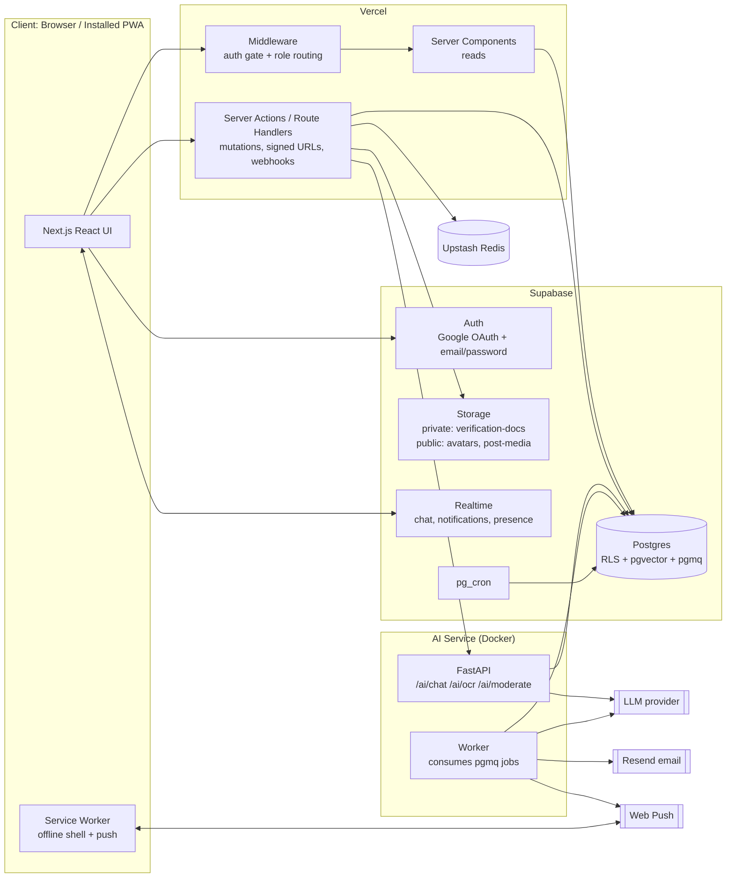
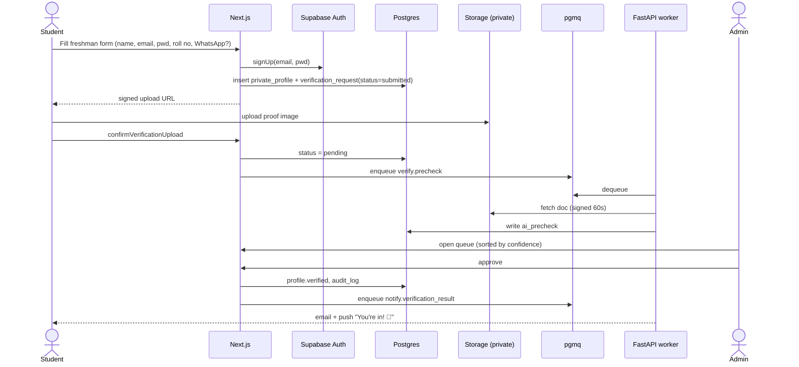

# UOSBuddy — Master Build Plan for Claude Code

> **UOSBuddy: Find your batch. Find your people.**
> *Your campus backup.*

A social, people-finding web app (installable PWA) for University of Sargodha (UoS) students. Students verify that they belong to UoS, find their batch, department and section, make friends, and get help ("backup") from batchmates and seniors. It also covers course rooms, notes, study groups, carpool and an AI study buddy.

---

## 0. How to use this document (instructions for Claude Code)

You are building UOSBuddy from scratch. Follow these rules for the entire project:

1. **Work phase by phase.** Do not start a phase until the previous phase's acceptance criteria pass. At the end of every phase, stop, summarise what was built, list anything deferred, and wait for the human to say "continue".
2. **Read Sections 2–4 (System Design) before writing any code.** The schema, state machines and security rules in Section 4 are the contract. If you need to change them, propose the change, explain why, and update this document in the same commit.
3. **Security is not a later phase.** Every table gets Row Level Security (RLS) on the day it is created. Never expose the Supabase `service_role` key to the browser.
4. **Mobile first.** Design every screen at 375px wide first, then scale up. The app must install as a PWA.
5. **Follow the design system in Section 6** for every screen. No default, unstyled shadcn look.
6. **Keep a `docs/DECISIONS.md` log.** Add one line for every non-obvious choice: what you chose, the alternatives and why.
7. **Tests.** Each phase lists required tests. Use Vitest for unit tests, Playwright for end-to-end flows, and pgTAP or SQL tests for RLS policies.
8. **Commits.** Use small, conventional commits (`feat:`, `fix:`, `chore:`), with one logical change per commit.
9. **Do not use the official University of Sargodha crest or logo** unless the human confirms written permission. Build an original UOSBuddy mark (Section 6.6). Add a footer line: "UOSBuddy is a student-run project and is not an official University of Sargodha service."

---

## 1. Research summary (what we learned from similar products)

### 1.1 UniPal (tryunipal.com): the closest competitor

Observed directly in a browser session, without logging in:

**Stack (confirmed):**
- Next.js (App Router) hosted on Vercel. The page metadata uses Next.js conventions and image URLs carry a Vercel deployment ID.
- Supabase as the whole backend. The browser calls `https://<project>.supabase.co/rest/v1/...` (PostgREST) directly with the anon key, protected by RLS.
- Tables and functions seen in network calls:
  - `allowed_domains` with columns `university, domain, campus_name, campus_letter, mail_host, returning_only`
  - `auth_providers` with columns `mail_host, live`
  - the RPC `my_university_status`, a Postgres function called after auth
- Google OAuth through Supabase Auth for students with a university email, plus email/password for freshmen.
- An installable PWA (manifest `start_url: /explore`), with a dark-first UI (`#0a0a0a`) and a lime accent.
- A small first-party analytics beacon (`POST /<hash>/view`).

**Onboarding flow (observed):**
1. Welcome: "Find your batch, your people, and your place before classes even start." with a "Get started" button.
2. "Which university are you at?": a searchable list. If the university is missing, the user sees "Can't find your university? Request your university", which works as a waitlist. **UoS is not listed on UniPal, so this is an open gap.**
3. "Do you have your student email?" with Yes and "No, not yet".
4. **Yes:** "Sign in with your <UNI> email", which uses Google sign-in restricted to the university domain.
5. **No (freshman):** "Join as a freshman". The form asks for full name, any personal email, password (at least 8 characters), WhatsApp number, a **screenshot proving admission** (portal page or similar), and a **roll number or portal unique number**, then "Submit for review". Copy: *"we check your screenshot by hand. It usually takes a few hours… only ever seen by an admin reviewing your account."*
6. Returning users log in with email and password ("Already applied? Sign back in").
7. A support email is shown on every auth screen.

**Features announced publicly** (founder's LinkedIn posts): find your batch and department people, Carpool, a PF (Programming Fundamentals) Tutor/Coach built around exam-style questions, and an in-app C++ editor with run and instant feedback.

### 1.2 Other products and the features worth borrowing

| Product | Best ideas to borrow |
|---|---|
| **Fizz** (US campuses, 3.5M monthly users) | Campus-verified anonymous feed; three-layer moderation (AI filter, then human reviewers, then **verified student moderators**); voice posts; event and study-session planning; sponsored student deals; growth through shareable screenshots of threads |
| **ZeeMee** | Discover students filtered by **major, home city, graduation year, dorm, interests**; **roommate matching quiz**; official campus chats; events; "Backpack" deals and scholarships feed |
| **Campify** | **Schedule import from a screenshot**; **free-time matching** with friends; "who's on campus now"; verified **course group chats**; clubs and events; **pings with temporary chats** ("you free?") |
| **Bumble For Friends** | **Interest badges** with filtering; **"Opening Moves"**, a preset question on a profile so starting a chat isn't awkward |
| **Yik Yak** | Hyper-local anonymous feed with upvote/downvote ranking; the lesson that anonymity without strong moderation kills the product |

### 1.3 UOSBuddy's differentiators

1. **UoS-only and deep, not broad and shallow.** It is built around UoS realities: departments, morning/evening shifts, sections, semesters, sessions (for example 2024–2028), day scholars and hostelites, and Sargodha travel routes.
2. **Backup Requests**, the signature feature: quick "I need help" posts that batchmates and seniors can claim.
3. **Free-slot matching from a timetable screenshot**, plus "Who's free now".
4. **An AI Buddy** grounded in UoS course outlines and past papers (RAG), not a generic chatbot.
5. **Privacy controls built for a Pakistani campus.** Photo visibility controls, "batch-only" visibility, women-only carpool and spaces as an option, and the WhatsApp number never shown publicly.
6. **AI-assisted verification.** OCR pre-checks the admission proof so an admin can approve in seconds, while a human still makes every decision.

---

## 2. Product requirements (summary)

### 2.1 Users and roles

| Role | Description |
|---|---|
| `visitor` | Not signed in. Sees the welcome and auth screens only. |
| `pending` | Signed up as a freshman and waiting for proof review. Can edit their profile draft and see status, nothing social. |
| `student` | A verified UoS student with full access. |
| `senior_mentor` | A student flag: opted in to mentor juniors. |
| `moderator` | A verified student moderator, scoped to the campus feed and course rooms. Can hide content and action reports. |
| `admin` | Reviews verifications, manages universities, departments and courses, bans users, sees analytics. |

### 2.2 Non-functional requirements

- **Scale (assumptions; confirm with the human):** up to 30k registered users, 5k daily active users, 500–1,000 peak concurrent users at semester start. Design the architecture so it could go multi-university later (one `universities` table, every row scoped by `university_id`).
- **Latency:** p95 under 300 ms for feed and directory reads; chat delivery under 500 ms.
- **Availability:** best effort, with 99.5% as the goal for managed services.
- **Mobile data:** the first page load (JavaScript) should stay under 200 KB gzipped where feasible. Images are served as AVIF/WebP and lazy-loaded. Many students are on 3G/4G.
- **Privacy:** collect the minimum PII. Delete verification documents 30 days after a decision. Show students what data is stored, and support account deletion and data export.
- **Accessibility:** WCAG 2.1 AA contrast, full keyboard navigation, and `prefers-reduced-motion` respected.
- **Localisation-ready:** English first, with string keys structured so Urdu can be added later (RTL-aware layout).

---

## 3. System Design: high level (HLD)

### 3.1 Architecture choice

**Recommended stack.** It mirrors what UniPal has proven and adds a Python service for the AI work:

| Layer | Choice | Why |
|---|---|---|
| Web app | **Next.js 15 (App Router) + TypeScript + Tailwind CSS + shadcn/ui (restyled) + Framer Motion** | Server Components for fast reads, Server Actions for mutations, PWA support, Vercel hosting |
| Backend-as-a-service | **Supabase**: Postgres 15+, Auth, Storage, Realtime, `pg_cron`, `pgvector`, `pgmq` | Auth, database, files, realtime and vectors in one place; RLS gives per-row security |
| AI / ML service | **FastAPI (Python 3.12)** in Docker | RAG tutor, OCR for verification and timetables, moderation, embeddings. This is where Python is the better tool. |
| Cache / rate limit | **Upstash Redis** | Rate limiting per user and per IP, hot counters, ephemeral "who's free now" presence |
| Background jobs | **Supabase `pgmq` queue + `pg_cron`**, consumed by a FastAPI worker | One less vendor; jobs are just rows |
| Email | **Resend** (or Supabase SMTP) | Verification results, digests |
| Push | **Web Push (VAPID)** through the service worker | Free, no app store needed |
| LLM | Provider-agnostic interface (an Anthropic Claude or OpenAI key in env) | Swappable |
| Code runner (later) | **Judge0 CE**, self-hosted, or the Piston API | Sandboxed C++/Python execution |
| Observability | **Sentry** (errors), **PostHog** (product analytics, feature flags), Supabase logs | |
| Hosting | Vercel (web), Supabase Cloud (database), Railway/Fly.io/Render (FastAPI + worker) | |

> Alternative if you want everything in your own control: replace Supabase with self-hosted Postgres + FastAPI REST + Socket.IO + S3/MinIO. That's more work but no vendor lock-in. **Start with Supabase.**

### 3.2 Component diagram



### 3.3 Key request flows

**A. Student with a UoS email (fast path)**
1. The user picks UoS, answers "Yes, I have my student email", and taps "Continue with Google".
2. Supabase Auth runs Google OAuth (passing a `hd` hint for the UoS domain). On callback, a database trigger `on_auth_user_created` checks the email domain against `university_domains`.
3. If the domain matches, `profiles.verification_status = 'verified'` and `verification_method = 'uni_email'`, and the user goes to profile setup.
4. If it doesn't match, the user is signed out and sees "That isn't a UoS email. Join as a freshman instead?"
5. An email/OTP magic-link option with the same domain check is the fallback for students whose university mail isn't Google-hosted.

**B. Freshman or no university email (manual path)**
1. The user signs up with any email, a password, and their roll or registration number. The WhatsApp number is optional.
2. They upload proof: an admission letter, portal screenshot, fee challan or student card. It goes to the **private** `verification-docs` bucket through a short-lived signed upload URL.
3. A `verification_requests` row is created with status `submitted`, and a `pgmq` job `verify.precheck` is queued.
4. The worker runs OCR and checks (Section 4.6), then writes `ai_precheck` (extracted name, roll number, university keywords, a confidence score and flags).
5. The admin queue shows the document beside the extracted fields and the form data. The admin approves, rejects with a reason, or asks for more information.
6. On approval, the profile becomes `verified` and the user gets an email and push notification. The document is deleted 30 days after the decision by `pg_cron`.
7. While pending, the user sees a friendly status screen with an estimated time, plus "Edit submission" and "Contact support".

**C. Sending a chat message**
1. The client calls the Server Action `sendMessage(conversationId, body)`.
2. Rate limit check (Redis): 20 messages per 10 seconds per user.
3. Insert into `messages`. RLS ensures the sender is a member of the conversation.
4. Supabase Realtime broadcasts the change to the `conversation:{id}` channel, and subscribers render it optimistically.
5. A database trigger updates `conversations.last_message_at`. Offline members get a queued push job (debounced to one per conversation per 2 minutes).

**D. Asking the AI Buddy**
1. The client posts to `/api/ai/chat`. The Next.js handler checks the session and quota, then streams from FastAPI `/ai/chat`.
2. FastAPI embeds the query, runs a vector search on `resource_chunks` filtered by `course_id`, builds a prompt with citations, and streams tokens back.
3. The answer, the sources used and token counts are stored in `ai_messages`.

**E. Backup Request**
1. A student posts "Need Week 5 OOP notes" and tags a course and urgency.
2. The fan-out job notifies eligible users: same course or section first, then the same department, then seniors who opted in. A cap of 50 notifications per request prevents spam.
3. A helper taps "I've got you", the request becomes `claimed`, and a temporary DM is opened.
4. The requester marks it `resolved`, and the helper earns "Backup points" toward a badge.

### 3.4 Data flow and storage overview

| Data | Store | Notes |
|---|---|---|
| Users, profiles, social graph, posts, chat | Postgres | RLS on every table |
| Avatars, post images | Storage (public bucket, image transforms) | Strip EXIF on upload |
| Verification documents | Storage (**private** bucket) | Admin-only signed URLs (60 seconds); auto-deleted |
| Notes and past papers (PDF) | Storage (authenticated bucket) | Virus-scan job and size limit (20 MB) |
| Embeddings | Postgres `pgvector` | `resource_chunks.embedding vector(1024)`; dimension set by the chosen model |
| Rate limits, presence, counters | Redis | TTL-based |
| Jobs | `pgmq` queues | `verify`, `notify`, `moderate`, `embed`, `ocr_timetable` |
| Analytics events | PostHog | No PII in event properties |

### 3.5 Scaling and capacity (back-of-envelope)

- **5k DAU × 40 reads/day = 200k reads/day (about 2.3 rps average, about 50 rps at peak).** A single Supabase Postgres instance is more than enough.
- **Chat: 5k DAU × 30 messages/day = 150k messages/day.** That's about 1.7 rps average, with spikes of 20–30 rps. Realtime handles this easily.
- **Storage:** 30k avatars × 100 KB is about 3 GB; notes are the main growth driver. Set per-user upload quotas.
- **Hot paths to index:** directory filters (`department_id, batch_year, section, shift`), feed (`created_at DESC`, `hot_score DESC`), and `messages (conversation_id, created_at DESC)`.
- **When to scale:** add read replicas at around 50k DAU, move chat to a dedicated service if realtime limits are hit, and add a CDN cache for public resources.
- **Multi-university later:** every table already has `university_id`, so add more domains and tenants without a schema rewrite.

### 3.6 Security model

1. **Authentication:** Supabase Auth with Google OAuth (domain-checked) and email/password with email confirmation. Sessions use secure HTTP-only cookies through `@supabase/ssr`.
2. **Authorization:**
   - RLS is the primary layer. Middleware is only a UX redirect, not a security boundary.
   - A helper SQL function `is_verified()` checks that `auth.uid()` has `verification_status = 'verified'` and `banned_at IS NULL`.
   - Almost every social table's policies require `is_verified()`.
3. **Least privilege:** `service_role` is used only in server code and the FastAPI worker. Admin pages also check `role = 'admin'` server-side.
4. **PII separation:**
   - Roll number, WhatsApp number and documents live in `verification_requests` and `private_profile`, which only the user and admins can read.
   - The public `profiles` view exposes only safe fields, gated by each user's privacy settings.
5. **Abuse and rate limits:**
   - Redis sliding-window limits on signups, posts, messages, connection requests (30 per day) and AI queries (quota per day).
   - Captcha (Cloudflare Turnstile) on signup and on the freshman form.
6. **Uploads:**
   - Use signed upload URLs with MIME and size checks.
   - Strip image metadata and reject executables.
   - Scan PDFs with ClamAV in the worker.
7. **Content safety:**
   - AI moderation runs before publishing in public spaces; flagged content is held for review.
   - Report flows on every user, post, comment and message.
   - Block hides users from each other everywhere.
8. **Web security:**
   - Set a CSP, HSTS, `X-Frame-Options: DENY` and SameSite cookies.
   - Validate every input with Zod on both client and server.
   - Never render untrusted HTML; markdown goes through a sanitiser.
9. **Audit log:** every admin and moderator action goes to `audit_log` (actor, action, target, before/after, timestamp).
10. **Data retention:**
    - Verification documents are deleted 30 days after decision.
    - Deleted accounts are hard-deleted after a 14-day grace period.
    - Messages from deleted users show "Deleted user".

---

## 4. System Design: low level (LLD)

### 4.1 Repository structure (monorepo)

```
uosbuddy/
├─ apps/
│  ├─ web/                      # Next.js 15 app
│  │  ├─ app/
│  │  │  ├─ (marketing)/        # welcome, about, privacy, terms
│  │  │  ├─ (auth)/             # /start, /university, /email, /freshman, /login, /pending
│  │  │  ├─ (onboarding)/       # /setup/* multi-step profile setup
│  │  │  ├─ (app)/              # authenticated shell with bottom nav
│  │  │  │  ├─ explore/         # batch finder + directory (PWA start_url)
│  │  │  │  ├─ people/[handle]/
│  │  │  │  ├─ feed/
│  │  │  │  ├─ backup/          # backup requests
│  │  │  │  ├─ chats/ & chats/[id]/
│  │  │  │  ├─ courses/[code]/  # course rooms + resources
│  │  │  │  ├─ timetable/
│  │  │  │  ├─ buddy/           # AI Buddy
│  │  │  │  ├─ rides/           # carpool
│  │  │  │  ├─ market/          # marketplace + lost & found
│  │  │  │  ├─ events/
│  │  │  │  └─ me/              # profile, settings, privacy, data export
│  │  │  ├─ admin/              # verification queue, reports, config, analytics
│  │  │  └─ api/                # route handlers (AI stream proxy, webhooks, push)
│  │  ├─ components/            # ui/ (design system), feature components
│  │  ├─ lib/                   # supabase clients, auth helpers, zod schemas, rate limit
│  │  ├─ actions/               # server actions grouped by domain
│  │  └─ public/                # manifest, icons, sw.js
│  └─ ai/                       # FastAPI service + worker
│     ├─ app/
│     │  ├─ main.py             # FastAPI app
│     │  ├─ routers/            # chat.py, ocr.py, moderate.py, embed.py
│     │  ├─ services/           # rag.py, ocr.py, llm.py, moderation.py, timetable.py
│     │  ├─ worker.py           # pgmq consumer loop
│     │  └─ db.py
│     ├─ tests/
│     └─ Dockerfile
├─ supabase/
│  ├─ migrations/               # numbered SQL migrations (schema + RLS + functions)
│  ├─ seed.sql                  # UoS, departments, sample courses, test users
│  └─ tests/                    # pgTAP RLS tests
├─ packages/
│  └─ shared/                   # shared TS types generated from DB (supabase gen types)
├─ docs/
│  ├─ BUILD_PLAN.md             # this file
│  ├─ DECISIONS.md
│  └─ research/unipal-rea.md    # output of Phase R
└─ .github/workflows/ci.yml
```

### 4.2 Enums

```sql
create type verification_status as enum ('unverified','pending','verified','rejected','needs_info');
create type verification_method as enum ('uni_email','document','admin_manual');
create type user_role as enum ('student','moderator','admin');
create type shift_type as enum ('morning','evening','weekend');
create type residence_type as enum ('day_scholar','hostelite','other');
create type program_level as enum ('associate','bs','bs_5th_semester','ms_mphil','phd','other');
create type connection_status as enum ('pending','accepted','declined','blocked');
create type visibility_level as enum ('everyone','department','batch','connections','nobody');
create type backup_status as enum ('open','claimed','resolved','expired','cancelled');
create type report_status as enum ('open','actioned','dismissed');
create type ride_role as enum ('driver','passenger');
create type listing_kind as enum ('sell','buy','free','lost','found');
create type conversation_kind as enum ('dm','group','batch','course','backup_temp');
```

### 4.3 Core schema

> All tables: `id uuid primary key default gen_random_uuid()`, `created_at timestamptz default now()`, plus `university_id uuid references universities(id)` wherever data is tenant-scoped. RLS is enabled on every table. The columns below are the minimum; extend with care.

**Tenant and catalogue**
```sql
universities(id, slug 'uos', name, short_name, city, roll_no_regex text, is_live bool)
university_domains(id, university_id, campus_id null, domain 'uos.edu.pk', student_only bool,
                   mail_host text,                       -- 'google' | 'microsoft' | 'other'
                   returning_only bool default false)    -- domain accepted only for returning students
  -- confirm UoS student mail domain(s) with the human before seeding
auth_providers(mail_host text primary key, live bool)  -- kill switch: hide OAuth, fall back to email OTP (#76)
campuses(id, university_id, name)                      -- main + sub-campuses if any
departments(id, university_id, campus_id, name, short_code 'CS', faculty)
programs(id, department_id, name 'BS Computer Science', level program_level, duration_semesters int)
courses(id, department_id, code 'CS-201', title, credit_hours, semester_hint int)
university_requests(id, name, email, created_at)       -- "request your university" waitlist (future multi-uni)
```

**Identity**
```sql
profiles(
  id uuid primary key references auth.users on delete cascade,
  university_id, handle citext unique, full_name, avatar_url,
  department_id, program_id, batch_year int,            -- session start year e.g. 2024
  semester int, section text, shift shift_type, residence residence_type,
  hometown_city text, bio text check (char_length(bio) <= 280),
  opening_move text,                                    -- Bumble-style icebreaker prompt answer
  pronoun_display text null,
  role user_role default 'student',
  is_mentor bool default false,
  verification_status verification_status default 'unverified',
  verification_method verification_method null,
  verified_at timestamptz, banned_at timestamptz, deleted_at timestamptz,
  onboarding_step int default 0,
  last_active_at timestamptz
)
private_profile(                                        -- only self + admin
  user_id pk references profiles, roll_no text, registration_no text,
  whatsapp text, personal_email text, uni_email text
)
privacy_settings(
  user_id pk, profile_visibility visibility_level default 'everyone',
  photo_visibility visibility_level default 'batch',
  show_hometown bool default true, show_in_directory bool default true,
  allow_dms_from visibility_level default 'everyone',
  show_free_now bool default false,                     -- opt-in
  women_only_spaces bool default false                  -- unlocks women-only rides/spaces if eligible
)
interests(id, slug, label, emoji, category)             -- seeded list (~80)
profile_interests(user_id, interest_id, primary key(user_id, interest_id))  -- max 10
verification_requests(
  id, user_id, university_id, method, status verification_status,
  doc_path text, roll_no_submitted text, full_name_submitted text,
  ai_precheck jsonb,                                    -- {name, roll_no, uni_match, confidence, flags[]}
  reviewer_id uuid null, decision_reason text, decided_at timestamptz,
  doc_deleted_at timestamptz
)
```

**Social graph and chat**
```sql
connections(id, requester_id, addressee_id, status connection_status, message text, responded_at,
            check (requester_id <> addressee_id))
  create unique index connections_pair_uq
    on connections (least(requester_id, addressee_id), greatest(requester_id, addressee_id));
blocks(blocker_id, blocked_id, primary key(blocker_id, blocked_id))
conversations(id, kind conversation_kind, title, course_id null, batch_key text null,
              created_by, last_message_at, expires_at null)   -- backup_temp expires
conversation_members(conversation_id, user_id, role text default 'member', last_read_at, muted bool,
                     primary key(conversation_id, user_id))
messages(id, conversation_id, sender_id, body text check (char_length(body) <= 4000),
         attachment_path null, reply_to_id null, edited_at, deleted_at)
  index on messages(conversation_id, created_at desc)
```

**Community**
```sql
posts(id, university_id, author_id, space text default 'campus',   -- campus | department:<id> | course:<id>
      body, media_paths text[], poll jsonb null, is_anonymous bool default false,
      upvotes int default 0, downvotes int default 0, comment_count int default 0,
      hot_score double precision, status text default 'published',  -- published|held|removed
      created_at)
  index on posts(university_id, space, hot_score desc)
  index on posts(university_id, space, created_at desc)
post_votes(post_id, user_id, value smallint check (value in (-1,1)), primary key(post_id,user_id))
comments(id, post_id, author_id, parent_id null, body, is_anonymous, status, created_at)
anon_aliases(post_id, user_id, alias text)              -- stable per-thread pseudonym ("Kinnow #42")
reports(id, reporter_id, target_type text, target_id uuid, reason text, details text,
        status report_status default 'open', handled_by, handled_at)
audit_log(id, actor_id, action text, target_type, target_id, before jsonb, after jsonb, created_at)
```

**Backup Requests (signature feature)**
```sql
backup_requests(id, university_id, requester_id, title, details, category text,  -- notes|help|ride|company|item|other
                course_id null, department_id null, urgency smallint (1..3),
                status backup_status default 'open', claimed_by null, claimed_at,
                resolved_at, expires_at default now() + interval '48 hours', conversation_id null)
backup_points(user_id pk, points int default 0, helped_count int default 0)
```

**Academics**
```sql
enrollments(user_id, course_id, term text '2026-fall', section text, primary key(user_id, course_id, term))
resources(id, course_id, uploader_id, kind text,        -- notes|past_paper|outline|slides|assignment
          title, file_path, year int, teacher_name text null, term text,
          upvotes int default 0, status text default 'pending_scan', embedded_at timestamptz)
resource_chunks(id, resource_id, chunk_index int, content text, embedding vector(1024), page int)
  index using hnsw (embedding vector_cosine_ops)
timetable_slots(id, user_id, term, day smallint (0..6), start_min smallint, end_min smallint,
                course_id null, label text, room text)
study_groups(id, course_id, creator_id, title, max_members int default 6, meets jsonb, conversation_id)
mentorships(id, mentor_id, mentee_id, status text, created_at)
ai_threads(id, user_id, course_id null, title, created_at)
ai_messages(id, thread_id, role text, content text, sources jsonb, tokens_in int, tokens_out int, created_at)
ai_quota(user_id, day date, used int, primary key(user_id, day))
```

**Campus life**
```sql
rides(id, university_id, user_id, role ride_role, from_area text, to_area text,
      depart_at timestamptz, recurring jsonb null, seats int, women_only bool default false,
      notes text, status text default 'open')
ride_requests(id, ride_id, user_id, status text, created_at)
listings(id, university_id, user_id, kind listing_kind, title, description, price_pkr int null,
         media_paths text[], status text default 'active', location_hint text)
societies(id, university_id, name, slug, description, logo_path, verified bool)
society_members(society_id, user_id, role text)
events(id, university_id, society_id null, title, description, starts_at, ends_at, venue, cover_path,
       capacity int null, created_by)
event_rsvps(event_id, user_id, status text, primary key(event_id, user_id))
```

**Notifications and engagement**
```sql
notifications(id, user_id, type text, actor_id null, entity_type, entity_id, payload jsonb,
              read_at null, created_at)
  index on notifications(user_id, created_at desc) where read_at is null
push_subscriptions(id, user_id, endpoint text unique, p256dh, auth, user_agent, created_at)
badges(id, slug, label, description, icon)
user_badges(user_id, badge_id, awarded_at)
invites(id, inviter_id, code text unique, uses int default 0)
```

### 4.4 RLS policy patterns (write these exactly in style)

```sql
-- helper
create or replace function public.is_verified() returns boolean
language sql stable security definer set search_path = public as $$
  select exists(select 1 from profiles p
    where p.id = auth.uid() and p.verification_status = 'verified'
      and p.banned_at is null and p.deleted_at is null);
$$;

create or replace function public.is_admin() returns boolean
language sql stable security definer set search_path = public as $$
  select exists(select 1 from profiles where id = auth.uid() and role = 'admin');
$$;

-- profiles: verified users can read profiles of their university that are visible to them
create policy profiles_read on profiles for select using (
  id = auth.uid()
  or (is_verified() and university_id = (select university_id from profiles where id = auth.uid())
      and not exists (select 1 from blocks b where (b.blocker_id = profiles.id and b.blocked_id = auth.uid())
                                             or (b.blocker_id = auth.uid() and b.blocked_id = profiles.id))
      and can_view_profile(auth.uid(), profiles.id))   -- applies privacy_settings
);
create policy profiles_update_self on profiles for update using (id = auth.uid())
  with check (id = auth.uid());   -- role/verification columns protected by a BEFORE UPDATE trigger

-- private_profile: self or admin only
create policy private_self on private_profile for all using (user_id = auth.uid() or is_admin());

-- messages: members only
create policy msg_read on messages for select using (
  exists (select 1 from conversation_members m where m.conversation_id = messages.conversation_id
          and m.user_id = auth.uid()));
create policy msg_insert on messages for insert with check (
  sender_id = auth.uid() and is_verified() and
  exists (select 1 from conversation_members m where m.conversation_id = messages.conversation_id
          and m.user_id = auth.uid()));

-- verification docs storage bucket: owner can upload into own folder, only admins can read
-- path convention: verification-docs/{user_id}/{uuid}.{ext}
```

**Protect sensitive columns.** A `BEFORE UPDATE` trigger on `profiles` raises an exception if a non-admin changes `role`, `verification_status`, `verification_method`, `verified_at` or `banned_at`.

**Anonymous posts.** `posts.author_id` must never reach clients for anonymous posts. Expose posts through a `posts_public` view (security invoker) that returns `author_id = null` and `anon_alias` when `is_anonymous`. Base-table SELECT is admin and moderator only.

### 4.5 State machines

**Verification**
```
unverified ──(uni email domain match)──────────────► verified
unverified ──(submit freshman form)──► pending
pending ──(admin approve)──► verified
pending ──(admin reject + reason)──► rejected ──(resubmit)──► pending
pending ──(admin needs info)──► needs_info ──(user updates)──► pending
verified ──(admin ban)──► (banned_at set; is_verified() = false)
```

**Connection:** `pending → accepted | declined`. Either side can `block` at any time, which deletes the connection and hides both users from each other.

**Backup request:** `open → claimed → resolved`. `open → expired` (cron after `expires_at`), `open|claimed → cancelled` by the requester, and `claimed → open` if the helper un-claims.

**Post:** `held` (moderation) → `published` → `removed` (moderator or admin, with audit_log).

### 4.6 Verification pre-check (FastAPI worker)

1. Download the document with the service role and a 60-second signed URL. Never persist it outside the bucket.
2. If it's a PDF, rasterise page 1. Run OCR (PaddleOCR, Tesseract or a vision LLM).
3. Extract the name, roll or registration number, the university name, the session or year, and the department.
4. Score it:
   - fuzzy name match against `full_name_submitted` (token-set ratio, 0–1)
   - the roll number matches `universities.roll_no_regex` and equals the submitted value
   - UoS keywords appear ("University of Sargodha", "UOS")
   - an image-tamper heuristic (EXIF editing software, inconsistent fonts, flagged when uncertain)
   - duplicate detection: the same roll number or a perceptual hash already used by another account
5. Write `ai_precheck = {name_match, roll_match, uni_match, duplicate_of, confidence, flags[]}`.
6. **Never auto-approve in v1.** Use the score only to sort the admin queue, high-confidence first. Later, auto-approve may be enabled behind a feature flag for `confidence > 0.95` with no flags.

### 4.7 Algorithms

**People suggestions ("People like you").** Candidates are verified, visible, not blocked and not already connected. Score each candidate:
```
score = 3.0*same_batch + 2.5*same_section + 2.0*same_department + 1.5*shared_courses_norm
      + 1.2*jaccard(interests) + 1.0*same_hometown + 0.8*mutual_connections_norm
      + 0.5*same_residence + 0.3*recently_active
```
Compute it in SQL (`suggest_people(limit, offset)` function), cache results per user in Redis for 15 minutes, and diversify so no more than 40% of results share the same top reason.

**Feed hot score** (Reddit-style, refreshed on vote via trigger):
```
s = upvotes - downvotes
order = log10(max(|s|, 1)); sign = sign(s)
hot_score = sign*order + (extract(epoch from created_at) - 1735689600) / 45000
```

**Free-slot matching.**
- Timetables are stored as `(day, start_min, end_min)`.
- Common free time for users A and B on a day is the window 08:00–17:00 minus the union of both users' busy slots.
- Return windows of at least 30 minutes.
- "Who's free now": users with `show_free_now = true` who have no slot covering the current time and who are present on campus (opt-in presence in Redis with a 30-minute TTL).

**Timetable from a screenshot.**
- The worker sends the image to a vision LLM with a strict JSON schema: `[{day, start, end, course_code, room}]`.
- Validate the output, show it to the user for confirmation and editing, and only then save it.

**Backup fan-out.**
- Notify tiers in order, stopping once 50 recipients are reached:
  1. same course (enrolled)
  2. same section
  3. same department and batch
  4. mentors in the department
- Skip users who have muted backup notifications or who received more than 5 backup pings today.

### 4.8 API surface (Server Actions and Route Handlers)

All inputs are validated with Zod. Every action returns `{ ok: true, data } | { ok: false, error: { code, message } }`.

| Domain | Action / Endpoint | Notes |
|---|---|---|
| Auth | `startGoogleSignIn(universitySlug)` | Sets the `hd` hint and redirect |
| | `GET /auth/callback` | Exchanges the code and routes by verification status |
| | `signUpFreshman(form)` | Creates the user, `private_profile` and `verification_request`; returns a signed upload URL |
| | `confirmVerificationUpload(requestId, path)` | Sets status to `pending` and queues `verify.precheck` |
| Onboarding | `saveOnboardingStep(step, data)` | Steps: academic, about, interests, privacy, photo |
| Directory | `getBatch({department, batchYear, section, shift})` | Paginated (cursor) |
| | `searchPeople(q, filters)` | Trigram search on name and handle |
| | `suggestPeople(cursor)` | |
| Connections | `sendConnection(userId, message?)`, `respondConnection(id, accept)`, `block(userId)`, `unblock` | |
| Chat | `getOrCreateDM(userId)`, `sendMessage`, `markRead`, `createGroup`, `leaveConversation` | |
| Feed | `createPost`, `vote`, `comment`, `report`, `deletePost` | Creation goes through the moderation pre-check |
| Backup | `createBackup`, `claimBackup`, `unclaimBackup`, `resolveBackup`, `cancelBackup` | |
| Academics | `joinCourse`, `uploadResource`, `listResources(courseId, kind)`, `voteResource` | |
| Timetable | `importTimetableFromImage(path)`, `saveTimetable(slots)`, `freeWith(userId)`, `whoIsFreeNow()` | |
| AI | `POST /api/ai/chat` (SSE stream) | Quota-checked |
| Rides | `createRide`, `requestSeat`, `respondSeat` | `women_only` enforced in RLS |
| Market | `createListing`, `markSold`, `listListings` | |
| Events | `createEvent`, `rsvp`, `listEvents` | |
| Notifications | `GET /api/push/subscribe`, `markNotificationsRead` | |
| Admin | `listVerificationQueue`, `decideVerification(id, decision, reason)`, `listReports`, `actionReport`, `banUser`, `manageCatalogue` | Server-side `is_admin()` check plus audit_log |
| Me | `exportMyData()` (a JSON zip by email), `deleteMyAccount()` | |

**FastAPI internal endpoints** (authenticated with a shared HMAC secret from Next.js; never called directly by the browser):
`POST /ai/chat` (stream), `POST /ai/moderate`, `POST /ai/ocr/verification`, `POST /ai/ocr/timetable`, `POST /ai/embed/resource`, `GET /health`.

### 4.9 Realtime channels

| Channel | Payload | Who subscribes |
|---|---|---|
| `conversation:{id}` | new, edited and deleted messages; typing (broadcast) | Members |
| `user:{id}` | notifications, connection requests, verification result | Self |
| `presence:campus:{university_id}` | "on campus / free now" (opt-in only) | Verified users with free-now enabled |
| `backup:{department_id}` | new open backup requests | Department members |

### 4.10 Sequence: freshman verification



### 4.11 Error handling and observability

- Typed error codes: `AUTH_REQUIRED`, `NOT_VERIFIED`, `FORBIDDEN`, `RATE_LIMITED`, `VALIDATION`, `NOT_FOUND`, `CONFLICT`, `UPSTREAM_AI`.
- UI: every error has friendly copy plus a retry action. Never show raw database errors.
- Sentry on web and AI, with release tags and user IDs hashed. Strip PII from breadcrumbs.
- Health checks: `/api/health` on web (checks the DB) and `/health` on FastAPI. Set up an uptime monitor.
- Structured JSON logs in FastAPI, with a `request_id` propagated from Next.js.

### 4.12 Testing strategy

| Layer | Tooling | Must cover |
|---|---|---|
| RLS | pgTAP (`supabase test db`) | Unverified users can't read profiles or posts; a blocked user is invisible; non-members can't read messages; anonymous authors are never exposed; a non-admin can't change their own role or verification |
| Unit | Vitest | Zod schemas, scoring functions, hot score, free-slot math |
| AI service | pytest | OCR extraction on fixture images, RAG retrieval returns course-scoped chunks, moderation thresholds |
| E2E | Playwright (mobile viewport) | Both onboarding paths, connect plus DM, backup request lifecycle, admin approve |
| Load (before launch) | k6 | 500 virtual users on the feed and chat; p95 targets from Section 2.2 |

---

## 5. Complete feature inventory

Priority key: **P0** = MVP launch, **P1** = first growth release, **P2** = later, **P3** = idea backlog. The phase number refers to Section 8.

### 5.1 Onboarding and identity

| # | Feature | Priority | Phase | Source |
|---|---|---|---|---|
| 1 | Animated welcome screen with tagline and "Get started" | P0 | 1 | UniPal |
| 2 | University and campus selection screen (UoS preselected, with UoS-themed mark and sub-campus picker); "Request your university" waitlist for future expansion | P0 | 1 | UniPal |
| 3 | "Do you have your UoS student email?" fork | P0 | 1 | UniPal |
| 4 | Sign in with UoS email (Google OAuth, domain-checked) plus email OTP fallback | P0 | 1 | UniPal |
| 5 | **Join as a freshman**: name, personal email, password, roll/registration number, optional WhatsApp, proof upload (admission letter, portal screenshot, fee challan, student card) | P0 | 1 | UniPal + yours |
| 6 | Pending-review screen with live status, ETA, edit submission and support link | P0 | 1 | yours |
| 7 | Returning-student login (email/password) and forgot password | P0 | 1 | UniPal |
| 8 | Upgrade path: a freshman later links their UoS email for a "UoS Email ✓" badge | P1 | 2 | new |
| 9 | Multi-step profile setup (department, program, session/batch, semester, section, shift, day scholar/hostelite, hometown, bio, photo) | P0 | 2 | yours |
| 10 | Interest badges (max 10) and an "Opening Move" icebreaker prompt | P0 | 2 | Bumble BFF |
| 11 | Privacy setup step (who sees photo, profile, DMs; directory opt-out) | P0 | 2 | new |
| 12 | AI-assisted verification pre-check (OCR, name and roll match, duplicate detection) | P1 | 7 | new |
| 13 | Profile completeness meter with nudges | P1 | 2 | common |
| 14 | Turnstile captcha on signup | P0 | 1 | security |

### 5.2 Discovery (people finding, the core loop)

| # | Feature | Priority | Phase |
|---|---|---|---|
| 15 | **Find My Batch**: an instant list of everyone in your department, session and section after onboarding | P0 | 3 |
| 16 | Department directory with filters (batch, section, shift, residence, hometown, interests) | P0 | 3 |
| 17 | Search by name or handle (trigram) | P0 | 3 |
| 18 | "People like you" suggestions with reason chips ("Same section", "Both into cricket") | P0 | 3 |
| 19 | Batch counter: "143 of your batch are already here", plus an invite link to fill it | P0 | 3 |
| 20 | Hometown connect: find students from your city or district (useful for travel and Eid trips) | P1 | 3 |
| 21 | Mutual connections on profiles | P1 | 4 |
| 22 | Senior mentor discovery (seniors in your department who opted in) | P1 | 6 |
| 23 | Hostel and roommate finder with a compatibility quiz (sleep time, cleanliness, study habits) | P2 | 8 |

### 5.3 Connections and chat

| # | Feature | Priority | Phase |
|---|---|---|---|
| 24 | Connect requests with an optional note (answering their Opening Move) | P0 | 4 |
| 25 | 1:1 DMs (realtime, typing indicator, read receipts, image attachments) | P0 | 4 |
| 26 | Message requests inbox for non-connections (respects `allow_dms_from`) | P0 | 4 |
| 27 | Auto-created batch and section group chats (opt-in join) | P0 | 4 |
| 28 | Custom group chats | P1 | 4 |
| 29 | **Ping**: "You free?" with a 2-hour temporary chat | P1 | 6 |
| 30 | Voice notes in chat | P2 | 4+ |
| 31 | Block, report and mute everywhere | P0 | 4 |

### 5.4 Community

| # | Feature | Priority | Phase |
|---|---|---|---|
| 32 | Campus feed and department feed (text, images, polls) with Hot/New sorting | P0 | 5 |
| 33 | Comments with one level of threading | P0 | 5 |
| 34 | Anonymous posting with stable per-thread aliases ("Kinnow #42") and stricter moderation | P1 | 5 |
| 35 | Q&A posts ("Which teacher for Stats?") with an accepted answer; powers the "Ask Seniors" lane (#79) | P0 | 5 |
| 36 | Societies directory and society pages | P1 | 8 |
| 37 | Events with RSVP, calendar export (.ics) and reminders | P1 | 8 |
| 38 | Official notices board (links out to UoS notices; no scraping without permission) | P2 | 8 |
| 39 | Student-moderator program (Fizz model) | P2 | 9 |
| 40 | Voice posts | P3 | — |

### 5.5 Backup Requests (signature)

| # | Feature | Priority | Phase |
|---|---|---|---|
| 41 | Create a request (notes, help, ride, company, item, other) with course tag and urgency | P0 | 5 |
| 42 | Smart fan-out notifications (course, then section, then department, then mentors) | P0 | 5 |
| 43 | Claim with "I've got you", a temporary chat, then resolve | P0 | 5 |
| 44 | Backup points, a "Campus Backup" badge and a monthly top-helpers board | P1 | 9 |

### 5.6 Academics

| # | Feature | Priority | Phase |
|---|---|---|---|
| 45 | Course rooms (one per course, auto-joined from enrolment) with chat and pinned info | P1 | 6 |
| 46 | Notes and past-paper library per course, with upvotes, year and teacher tags | P1 | 6 |
| 47 | Timetable: manual entry plus **import from a screenshot** (vision LLM) | P1 | 6 |
| 48 | **Free together**: common free slots with a friend or group | P1 | 6 |
| 49 | **Who's free now** (opt-in, on-campus presence) | P2 | 6 |
| 50 | Study-group finder and creator (course, time, size) | P1 | 6 |
| 51 | **AI Buddy**: RAG over course outlines, notes and past papers, with citations | P1 | 7 |
| 52 | Exam-style practice generator (MCQs and short questions from past-paper style) with explanations | P2 | 7 |
| 53 | In-app code runner for CS courses (C++/Python, Judge0) and "PF Coach" problems | P2 | 7 |
| 54 | GPA/CGPA calculator using the UoS grading scheme | P1 | 6 |
| 55 | Datesheet and assignment deadline reminders | P2 | 6 |
| 56 | Teacher and course reviews (moderated, constructive only) | P3 | — |

### 5.7 Campus life

| # | Feature | Priority | Phase |
|---|---|---|---|
| 57 | **Carpool / rides**: driver or passenger, routes around Sargodha and the home districts, recurring rides, seats, women-only option | P1 | 8 |
| 58 | Marketplace: books, calculators, hostel items; price in PKR | P1 | 8 |
| 59 | Lost and found | P1 | 8 |
| 60 | Campus map and places (cafés, labs, photocopy shops, offices) | P2 | 8 |
| 61 | Student deals feed (local businesses) | P3 | — |

### 5.8 Notifications, engagement and growth

| # | Feature | Priority | Phase |
|---|---|---|---|
| 62 | In-app notification centre (realtime) | P0 | 5 |
| 63 | Web push for DMs, connection accepted, backup claimed and verification result | P0 | 5 |
| 64 | Invite links and "Invite your batch" share card (dynamic OG image with batch count) | P0 | 3 |
| 65 | Badges (Verified, Early Bird, Campus Backup, Mentor, Top Contributor) | P1 | 9 |
| 66 | Weekly email digest ("12 new batchmates joined") | P2 | 9 |
| 67 | Installable PWA with an "Add to Home Screen" coach mark | P0 | 10 |

### 5.9 Safety, trust and admin

| # | Feature | Priority | Phase |
|---|---|---|---|
| 68 | Admin verification queue (document viewer, AI pre-check panel, approve, reject, needs-info, keyboard shortcuts) | P0 | 1 |
| 69 | Reports queue and moderation actions (hide, remove, warn, ban) with audit log | P0 | 9 (basic in 4/5) |
| 70 | AI content moderation pre-check for posts, comments and listings | P1 | 7 |
| 71 | Rate limiting on all write paths | P0 | 1+ |
| 72 | Safety centre page (how to report, women's safety tips, contacts) | P1 | 9 |
| 73 | Data export and account deletion | P0 | 9 |
| 74 | Admin analytics (signups by department, verification funnel, DAU, retention) | P1 | 9 |
| 75 | Catalogue management (departments, programs, courses) and feature flags | P0 | 1 / 9 |

### 5.10 Additions from the UniPal teardown (approved 2026-10-23)

Details and evidence are in `docs/research/unipal-rea.md`. #76's schema change is applied in Section 4.3.

| # | Feature | Priority | Phase | Source |
|---|---|---|---|---|
| 76 | Per-campus mail domains and provider kill switch (`university_domains.campus_id, mail_host, returning_only` + `auth_providers(mail_host, live)`; OTP fallback when a provider isn't live) | P0 | 1 | UniPal-REA |
| 77 | Freshman form draft restore (non-secret fields only, "We kept what you typed" + "Start over") | P0 | 1 | UniPal-REA |
| 78 | URL-driven onboarding state + validated `next=` return after auth | P0 | 1 | UniPal-REA |
| 79 | "Ask Seniors" Q&A lane routed to opted-in seniors (promotes #35 to P0) | P0 | 5 | UniPal-REA |
| 80 | Top-level Resources hub `/resources` (cross-course search by code, teacher, year) | P1 | 6 | UniPal-REA |
| 81 | Human-touch copy on waitlist and pending screens | P1 | 1 | UniPal-REA |
| 82 | Public legal pages, `robots.txt` and `sitemap.xml` shipped in Phase 1 (UniPal gates them behind login) | P0 | 1 | UniPal-REA |

---

## 6. Design system and UI direction

### 6.1 Reference boards (from Cosmos)

**Reference A**, `cosmos.so/e/2001221636`: a micro-interaction showcase.
- A soft off-white canvas with a faint **dotted grid**.
- A row of tactile, glossy **app icons**, each with a small **pill label** underneath.
- On hover or tap, an icon lifts and **fans out a stack of app screenshots** behind it, with a bold title, a one-line description and a small pill CTA.
- Lots of air, centred composition, buttery spring motion.

**Reference B**, `cosmos.so/e/1502143211`: a playful retro promo layout.
- A **warm cream/paper background** with near-black ink.
- A giant **pixel/bitmap display headline**.
- A **3D retro TV object** with an **iridescent holographic screen and a smiley face** overlapping the headline.
- A centred short paragraph, a **dark pill button**, a horizontal **marquee ticker** ("ONLY TODAY → ONLY TODAY →") and product cards below.

**Reference C**, `cosmos.so/e/1275602415`: a four-colour category system (colour chosen by the human for the brand).
- Four saturated hues (violet, mint, cyan, blue) on deep navy, one per business line, each with an icon and label.
- Each hue has a stepped tint ladder (base, then two lighter tints, then a dark shade).

**Reference D**, `cosmos.so/e/1390293619`: the "ctrl+" brand board (colour chosen by the human for the brand).
- Palette: cobalt `#0034D3`, cream `#F2ECE1`, sky `#99CCFF`, navy `#003087`.
- A hand-drawn script wordmark, playful squiggle doodles as pattern, and a cobalt + cream card system.

**The synthesis for UOSBuddy is "Retro-tactile campus".** That means calm, airy and friendly layouts (A), punctuated by playful retro moments (B): pixel display type, a holographic accent and a mascot. It must feel friendly first and premium second, never childish.

**Colour (from C and D):**
- The brand is **cobalt on cream**, and dark mode is **deep navy with sky blue**.
- Each feature area gets its own **lane colour** from Reference C, used on feature tiles, stamps and section headers, never for body text.
- Ref D's squiggle doodles become a decorative pattern on empty states and share cards.

### 6.2 Design tokens

```css
:root {
  /* Surfaces */
  /* Surfaces */
  --bg: #F2ECE1;            /* cream (Ref D) */
  --bg-grid-dot: #DDD5C6;   /* dotted canvas (Ref A) */
  --surface: #FFFFFF;
  --surface-2: #E9E2D4;
  --ink: #0B0838;           /* navy ink: text & primary buttons (Ref C background) */
  --ink-2: #4A4766;         /* secondary text */
  --line: #DDD5C6;
  /* Brand (Ref D) */
  --brand: #0034D3;         /* cobalt */
  --brand-ink: #FFFFFF;
  --brand-soft: #99CCFF;    /* sky */
  --brand-deep: #003087;    /* navy */
  /* Feature lanes (Ref C); tiles, stamps, headers only */
  --lane-people: #6553F5;   /* Batch, Chats; white text on it */
  --lane-learn: #00D68F;    /* Courses, Resources, AI Buddy; ink text */
  --lane-help: #2EC8FF;     /* Backup, Ask Seniors; ink text */
  --lane-campus: #0034D3;   /* Rides, Market, Events; shares the brand cobalt */
  --accent-holo: linear-gradient(135deg,#99CCFF 0%,#6553F5 35%,#2EC8FF 65%,#00D68F 100%); /* mascot screen */
  --success: #00A86B; --warning: #D99A1E; --danger: #D64545;
  /* Shape */
  --radius-sm: 10px; --radius-md: 16px; --radius-lg: 24px; --radius-pill: 999px;
  --shadow-card: 0 1px 0 rgba(11,8,56,.04), 0 8px 24px -12px rgba(11,8,56,.18);
  --shadow-lift: 0 18px 40px -16px rgba(11,8,56,.35);
}
@media (prefers-color-scheme: dark) {
  :root:not([data-theme="light"]) {
    --bg: #0B0838; --bg-grid-dot: #1C1757; --surface: #141046; --surface-2: #1C1757;
    --ink: #F2ECE1; --ink-2: #A9A6C9; --line: #2A2566;
    --brand: #99CCFF; --brand-ink: #0B0838;
  }
}
:root[data-theme="dark"] {
  --bg: #0B0838; --bg-grid-dot: #1C1757; --surface: #141046; --surface-2: #1C1757;
  --ink: #F2ECE1; --ink-2: #A9A6C9; --line: #2A2566;
  --brand: #99CCFF; --brand-ink: #0B0838;
}
/* Checked WCAG contrast: ink/bg 16.2, brand/bg 7.3, white/brand 8.6, white/violet 5.1,
   ink/mint 10.0, ink/cyan 9.8; dark: ink/bg 16.2, sky/navy 11.2, ink-2/surface 7.5 */
```

- **Typography:**
  - **Display:** a pixel font such as `Silkscreen` or `Pixelify Sans` (Google Fonts). Use it **only** for big hero words, section stamps and numbers ("143 BATCHMATES"), at 32px and above.
  - **UI and body:** `Geist` or `Inter`, at 15–16px base size with 1.5 line height.
  - **Urdu (later):** `Noto Nastaliq Urdu`.
- **Spacing:** a 4px base scale (4, 8, 12, 16, 24, 32, 48, 64). The page side gutter is 16px on mobile and 24px on desktop.
- **Icons:** Lucide at stroke 1.75. Feature icons use **glossy, tactile app-icon tiles** (Ref A), one per major feature (Batch, Backup, Rides, Buddy, Market, Events).

### 6.3 Signature components

1. **Dotted canvas.** A `body` background of CSS radial-gradient dots on cream. Use it on the welcome, empty states and the explore hub.
2. **Feature dock (Ref A).**
   - The Explore hub shows a row or grid of tactile icon tiles with pill labels.
   - Tapping a tile springs it up and fans 2–3 preview cards (Framer Motion `layoutId` + spring, stiffness 260, damping 22), then navigates.
   - Long-press on mobile does the same.
3. **Pill buttons.** The primary button is ink-filled with cream text, fully rounded, 48px tall on mobile. The secondary button is outlined. The press state scales to 0.97.
4. **Marquee ticker (Ref B).** A slow horizontal ticker for live campus pulses ("12 new batchmates today → Backup claimed in CS-201 → Rides to Lahore Friday →"). Pause it on hover and under `prefers-reduced-motion`.
5. **Mascot, "Buddy".**
   - An original retro-TV/handheld-console character with a holographic screen showing expressions: smile, wink, thinking, party.
   - Use it on the welcome, pending verification ("checking your proof…"), empty states, AI Buddy and success moments.
   - Build it as SVG plus a CSS holographic gradient. Do not copy the reference object exactly; make it your own.
6. **Person card.** Avatar (respecting photo visibility), name, `CS · 2024 · Sec B · Morning`, up to 3 interest chips, reason chip ("Same section"), and a Connect pill.
7. **Stamp badges.** Pixel-font mini stamps for "VERIFIED", "UOS EMAIL", "MENTOR" and "BACKUP HERO".
8. **Bottom navigation (mobile):** Explore · Feed · Backup (center, raised) · Chats · Me.

### 6.4 Motion principles

- Use spring physics, not linear easing. Durations run from 180–320 ms.
- **Entry:** stagger lists by 30 ms and fade up 8px.
- **Delight moments** come once per milestone, never on every action:
  - confetti and the mascot party face when verified
  - a soft haptic (`navigator.vibrate(10)` where supported) when a backup is claimed
- Under `prefers-reduced-motion`, there are no fans, no marquee and no confetti.

### 6.5 UX principles

- **One primary action per screen.** Progress dots during onboarding, at most 6 steps.
- **Explain why we ask.** Each sensitive field gets a one-line reason ("Only an admin sees this. Deleted after review.").
- **Empty states sell the next action.** For example, "Your section is quiet. Invite 3 classmates", with a share button.
- **Skeleton loaders, not spinners.** Optimistic UI for votes, connects and messages.
- **Thumb zone:** primary actions at the bottom on mobile. Tap targets are at least 44px.
- **Respect bandwidth:** blurred placeholders for images and no autoplay video.

### 6.6 Brand mark (UoS-related, original)

- An original monogram: a **"U" shaped like two people / a handshake** inside a rounded app-icon tile. A pixel-style "UOSBUDDY" wordmark sits beside it.
- The palette is cobalt, cream and navy (Ref D), with no borrowing from the university crest. The human will brief the logo idea before Phase 0's icon work.
- Deliver SVG logo, maskable PWA icons (192 and 512), a favicon and an OG image template.
- Add the footer disclaimer from Section 0, rule 9.

---

## 7. Screen-by-screen: onboarding (P0)

| # | Route | Screen | Content and behaviour |
|---|---|---|---|
| 1 | `/` | **Welcome** | Dotted canvas. The mascot waves in. Pixel headline "FIND YOUR BATCH." Subline "Your people at University of Sargodha, before classes even start." Primary pill "Get started" and a secondary text link "I already have an account". A marquee shows live stats (e.g. "1,204 students joined"). |
| 2 | `/start/campus` | **University and campus** | UoS card preselected with the brand mark and a "University of Sargodha" label. A sub-campus or department-location picker if configured. "Not from UoS? Request your university" opens the waitlist form. |
| 3 | `/start/email` | **Email fork** | "Do you have your UoS student email?" Two big pills: "Yes, I have it" and "No, I'm a fresher / don't have it yet". |
| 4a | `/start/uni-email` | **Sign in with UoS email** | "Continue with Google" (domain-hinted) and an "Email me a code" fallback. On wrong domain: "That's not a UoS email. Join as a fresher instead?" |
| 4b | `/start/freshman` | **Join as a fresher** | Fields: full name, personal email, password (strength meter), roll/registration number (validated against `roll_no_regex`, with a format hint), WhatsApp (optional, "only admins see this"), proof upload (camera or gallery; accepted types listed with examples). A privacy note: "Only a verifier sees your document. It's deleted 30 days after review." Turnstile, then "Submit for review". |
| 5 | `/pending` | **Under review** | Mascot "checking…" animation. Status timeline (Submitted → In review → Decision). "Usually within 12 hours." Edit submission and contact support. Push opt-in: "Want a ping when you're in?" |
| 6 | `/setup/academic` | **Academic** | Department → program → session (batch year) → semester → section → shift. Searchable selects from the catalogue. |
| 7 | `/setup/about` | **About you** | Photo (cropper, visibility selector), handle (live availability check), bio, hometown city, day scholar/hostelite. |
| 8 | `/setup/interests` | **Interests and Opening Move** | Pick up to 10 interest chips by category. Choose a prompt ("Ask me about…", "Best chai spot near campus is…") and answer it. |
| 9 | `/setup/privacy` | **Privacy** | Simple presets (Open / Batch-only / Private) with an advanced toggle for each setting. |
| 10 | `/explore?welcome=1` | **Your batch reveal** | A big pixel number "143" counts up: "of your batch are already here". Fanned person cards, a "Connect with your section" bulk-suggest, and an invite-your-batch share card. |

---

## 8. Build phases for Claude Code

> At the end of each phase: run all tests, update `docs/DECISIONS.md`, and post a summary with screenshots (Playwright) of new screens at 375px and 1280px. **Stop and wait for "continue".**

### Phase R: Research. Reverse-engineer UniPal with the REA skill

**Goal:** Produce `docs/research/unipal-rea.md`, a complete feature and UX teardown of tryunipal.com to fill gaps in Section 5.

**Instructions:**
1. **Use the `REA` skill** (reverse-engineering analysis) if it is installed in this environment. If it isn't, tell the human and follow the manual protocol below.
2. Use a real browser session. Start at `https://www.tryunipal.com/` and walk through every **publicly reachable** screen: welcome, university picker, email fork, freshman form, login, and any public pages.
3. For each screen, record:
   - the route
   - its purpose
   - every UI element and the copy tone
   - validation rules you can see
   - empty and error states
   - the network calls shown in DevTools (endpoint names and table or RPC names only)
4. If the human provides a test account that they own, explore the logged-in app (`/explore` and beyond) the same way. Map every feature (batch finder, carpool, PF Tutor/Coach, code runner, profiles, chat, settings).
5. Also mine the founder's public build-in-public posts and the app's metadata for announced features.
6. **Output:**
   - a feature matrix "UniPal vs UOSBuddy (Section 5)" marking Have / Missing / Better-idea
   - a list of **new features to add**, each with a proposed priority and phase
   - UX patterns worth copying, and patterns to avoid
7. Update Section 5 of this document with the new features, marked `source: UniPal-REA`.

**Ethical and legal limits (mandatory):**
- Observe only. Do not submit forms with fake data, create fake accounts or upload documents.
- Do not query their Supabase/PostgREST endpoints directly or try to read tables beyond what the UI itself loads. That could be unauthorised access even with a public anon key.
- Do not scrape other users' data, and do not copy their code, copy text, logo or visual identity. The goal is to learn features, then design our own.

**Already known** (from an earlier manual session, Section 1.1): Supabase tables `allowed_domains` and `auth_providers`, the RPC `my_university_status`, Google sign-in for university email, a freshman screenshot review with roll number and WhatsApp, a university waitlist, carpool, PF Tutor/Coach and a C++ runner.

**Acceptance:** `unipal-rea.md` exists, Section 5 is updated, and the human has approved the additions.

### Phase 0: Foundation

**Tasks**
1. Monorepo setup:
   - pnpm workspaces
   - `apps/web` with Next.js 15, TypeScript strict, ESLint and Prettier
   - `apps/ai` with FastAPI, uv/poetry, Ruff, pytest and a Dockerfile
   - `supabase/` initialised locally with `supabase start`
2. Tailwind and design tokens from Section 6.2:
   - fonts (Silkscreen + Geist)
   - restyled shadcn primitives: Button (pill), Input, Select, Sheet, Dialog, Toast, Tabs, Avatar, Badge/Stamp
   - the dotted canvas
3. A `/design` route that renders every component in light and dark mode (a living style guide).
4. Supabase clients (`@supabase/ssr`) for server, browser and middleware. Generate types into `packages/shared`.
5. Env handling with Zod (`env.ts`) and a `.env.example` listing every variable (Appendix A).
6. CI (GitHub Actions): lint, typecheck, unit tests, `supabase db lint`, and pgTAP against a local Supabase.
7. A PWA skeleton: `manifest.webmanifest` (start_url `/explore`, theme colours, maskable icons placeholder) and a minimal service worker.
8. Sentry and PostHog wiring (disabled when keys are missing).

**Acceptance:** `pnpm dev` runs web, Supabase and AI locally. `/design` shows all components. CI is green. Lighthouse PWA install criteria pass.

### Phase 1: Auth and verification (P0)

**Tasks**
1. Migrations:
   - `universities`, `university_domains`, `campuses`, `departments`, `programs`, `courses`, `university_requests`
   - `profiles`, `private_profile`, `privacy_settings`, `verification_requests`, `audit_log`
   - the enums, helpers (`is_verified`, `is_admin`) and the protected-columns trigger
   - all RLS policies
2. Seed UoS:
   - **Ask the human** for the real student email domain(s), the roll/registration number format and the department list. Use placeholders until then.
3. Screens 1–5 from Section 7, including the waitlist form.
4. Google OAuth with the `hd` hint plus a server-side domain check in the callback and a DB trigger. Email OTP fallback.
5. Freshman signup:
   - signed upload to the private `verification-docs` bucket (images and PDFs, at most 8 MB)
   - client-side image compression (`browser-image-compression`)
   - EXIF strip
6. Pending screen with realtime status updates (`user:{id}` channel).
7. **Admin verification queue** (`/admin/verifications`):
   - a split view with the document (signed URL, zoom and rotate) on one side and the submitted fields on the other
   - approve, reject (reason templates) and needs-info actions
   - keyboard shortcuts (A/R/N, J/K)
   - every action writes `audit_log`
8. Middleware routing by state:
   - `visitor` → `/`
   - `pending` → `/pending`
   - verified but not onboarded → `/setup/*`
   - verified → `/explore`
9. Rate limits (Upstash) on signup and upload. Turnstile.
10. Email notifications (Resend) for submitted, approved and rejected.

**Tests**
- pgTAP:
  - a pending user cannot read profiles
  - a user cannot set their own `verification_status`
  - only an admin can read `verification-docs`
- Playwright: both onboarding paths end to end (Google mocked with a test provider or a seeded session), and admin approve.

**Acceptance:** A UoS-email user reaches setup in under 30 seconds. A freshman can submit, an admin can approve, and the freshman is redirected live. All RLS tests pass.

### Phase 2: Profile and onboarding completion (P0)

**Tasks**
1. Migrations: `interests`, `profile_interests`. Seed about 80 interests (Cricket, Coding, Poetry/Shayari, Gaming, Debating, Photography, Naats, Gym, Football, Design, Startups, Books, Anime, Cooking…).
2. Screens 6–9 from Section 7:
   - multi-step with progress dots
   - autosave per step (`saveOnboardingStep`)
   - back and forward navigation
3. Handle availability check (debounced) and profanity filter.
4. Avatar upload with a cropper, to the public `avatars` bucket with transforms (128 and 512).
5. Profile page `/people/[handle]`, honouring privacy settings, plus an own-profile edit view.
6. Settings → Privacy (presets plus advanced options).
7. Profile completeness meter.
8. The "Link your UoS email later" upgrade flow (adds the UOS EMAIL stamp).

**Tests:** `can_view_profile` matrix tests (everyone, department, batch, connections, nobody × viewer type). E2E onboarding resume after a page reload.

**Acceptance:** Onboarding completes in at most 6 steps. Privacy settings demonstrably hide fields from other users.

### Phase 3: Discovery, "Find your batch" (P0)

**Tasks**
1. `/explore` hub:
   - the feature dock (Section 6.3 #2)
   - a batch summary card
   - the marquee ticker
2. **Batch reveal** screen (Section 7 #10) on first visit.
3. Directory `/explore/batch`:
   - tabs: My Section · My Batch · My Department · All UoS
   - filter sheet (shift, residence, hometown, interests)
   - cursor pagination, virtualised list
4. Search: `pg_trgm` index on `full_name` and `handle`, and a `searchPeople` action.
5. `suggest_people()` SQL function (Section 4.7) with reason chips, cached in Redis.
6. Invites:
   - `invites` table and a `/i/[code]` landing page
   - a dynamic OG image ("143 of CS 2024 are on UOSBuddy"), built with `next/og`
   - the native share sheet
7. Hometown view: "From your city".

**Tests:** Suggestions exclude blocked, unverified and hidden users. Directory p95 under 300 ms on 30k seeded profiles (write a seed script with faker).

**Acceptance:** A newly verified user sees their batch within 2 seconds of finishing onboarding.

### Phase 4: Connections and chat (P0)

**Tasks**
1. Migrations: `connections`, `blocks`, `conversations`, `conversation_members`, `messages`, `reports`, plus RLS.
2. Connect flow: a sheet with an Opening Move reply, and accept or decline from notifications and the profile.
3. Chats list `/chats` (Primary · Requests · Groups) and conversation view `/chats/[id]`:
   - realtime via `conversation:{id}`
   - optimistic send, typing indicator, read receipts
   - image attachments
   - infinite scroll back in time
4. Auto batch and section group chats (created lazily the first time someone joins); joining is opt-in.
5. Custom groups (name, emoji, up to 50 members).
6. Block, report and mute on profiles, messages and chats.
7. Rate limits: messages, and connection requests (30 per day).

**Tests:**
- pgTAP: non-members can't read messages; blocked users can't DM each other.
- E2E: two browser contexts exchanging messages in realtime.

**Acceptance:** Message delivery under 500 ms locally. Blocking instantly hides users everywhere (directory, search, chat, feed).

### Phase 5: Feed, Backup Requests and notifications (P0)

**Tasks**
1. Migrations: `posts`, `post_votes`, `comments`, `anon_aliases`, `backup_requests`, `backup_points`, `notifications`, `push_subscriptions`, plus the `posts_public` view.
2. Feed `/feed`:
   - Campus and Department tabs, Hot/New sorting
   - composer (text, up to 4 images, poll)
   - votes, comments, report
   - hot score trigger
3. Anonymous posting (P1, behind a feature flag): aliases, stricter rate limits, held for moderation when flagged.
4. **Backup Requests** `/backup`:
   - create sheet (category, course, urgency, details)
   - an "Open near you" list
   - claim, which creates a `backup_temp` conversation that expires 72 hours after resolution
   - resolve and cancel; expiry via `pg_cron`
   - fan-out job (Section 4.7)
5. Notification centre (bell plus a `/notifications` page) with realtime updates on `user:{id}`.
6. Web Push:
   - VAPID keys
   - a subscription UI with a soft-ask after the first meaningful action, not on page load
   - a worker sends pushes
   - per-type preferences in settings
7. Worker jobs: `notify.push`, `notify.email`, `backup.fanout`.

**Tests:** Anonymous author never appears in any API response (assert it in an E2E network capture). Backup lifecycle E2E. Fan-out cap respected.

**Acceptance:** A backup request reaches classmates' phones as a push notification within 10 seconds.

### Phase 6: Academics (P1)

**Tasks**
1. Migrations: `enrollments`, `resources`, `timetable_slots`, `study_groups`, `mentorships`.
2. Course catalogue browsing and "My courses" (join or leave for the current term).
3. Course room `/courses/[code]`:
   - a chat (`kind = 'course'`)
   - resources tab (upload PDF/image; tags for kind, year and teacher; upvotes)
   - study groups tab
4. Resource upload pipeline:
   - signed upload
   - `pending_scan` status, then ClamAV scan in the worker, then `published`
   - queue an `embed` job for later RAG
5. Timetable `/timetable`:
   - week grid with manual add and edit
   - **import from a screenshot** (vision LLM via FastAPI with a strict JSON schema; the user confirms before saving)
6. **Free together:** pick friends or a group to see common free windows (Section 4.7). **Who's free now:** an opt-in presence toggle.
7. Ping: "You free?" from a profile or free-now list, which creates a 2-hour temporary chat.
8. Senior mentors: opt-in on the profile, a "Find a mentor" list in the department, and a request flow.
9. GPA/CGPA calculator:
   - **ask the human for the UoS grading table** before implementing
   - save semesters locally or to the profile (private)

**Tests:** Free-slot unit tests (overlaps, edge minutes, empty timetables). Timetable OCR fixtures.

**Acceptance:** A student can import a timetable screenshot and see a free slot shared with a friend in under 1 minute.

### Phase 7: AI layer (P1)

**Tasks**
1. FastAPI services:
   - an `llm.py` provider abstraction (streaming)
   - `embed.py` (chunking at 800 tokens with 100 overlap, page-aware)
   - `rag.py` (hybrid retrieval: pgvector cosine plus Postgres full-text, then reciprocal rank fusion and a top-k of 6, filtered by `course_id`)
2. Embed pipeline: the worker consumes `embed` jobs for published resources and course outlines.
3. **AI Buddy** `/buddy`:
   - a course selector and threaded chats
   - streaming answers with **citations** that link to the resource page
   - "I don't know from your course materials" fallback behaviour
   - a daily quota (for example 30 messages), shown in the UI
   - a system prompt that refuses to write graded assignments wholesale and explains and teaches instead
4. Practice mode (P2): generate MCQs and short questions in the style of past papers, with grading and explanations.
5. **AI moderation pre-check** for posts, comments, listings and anonymous content. Thresholds:
   - allow
   - hold for review
   - block (hate, harassment, sexual content, doxxing / PII such as phone numbers in public posts)
6. **Verification pre-check** (Section 4.6). The admin queue is sorted by confidence and shows flags.
7. Code runner (P2): a Judge0 integration behind FastAPI, a Monaco editor in the web app, C++ and Python, time and memory limits, and "PF Coach" problem sets with test cases.

**Tests:** RAG returns only chunks from the requested course. Moderation fixtures. Quota enforcement. Prompt-injection tests (resource text containing "ignore previous instructions" must not change behaviour).

**Acceptance:** AI Buddy answers with at least one valid citation for 8 of 10 seeded questions.

### Phase 8: Campus life (P1)

**Tasks**
1. **Rides** `/rides`:
   - offer or request; from and to areas (seeded list: campus gates, city areas, nearby cities); time; recurring days; seats
   - **women-only** (visible and joinable only by eligible users, enforced in RLS)
   - request a seat, then the driver accepts, then a group chat is created
   - safety tips banner; never show phone numbers
2. **Marketplace and lost-and-found** `/market`:
   - listings with photos, PKR price and kind tabs
   - "Mark sold/found"
   - chat with the seller (DM)
3. **Societies and events** `/events`:
   - society pages (admin-verified)
   - event creation by society admins
   - RSVP, .ics export and a reminder push 1 hour before
4. Hostel/roommate finder (P2): a quiz and compatibility score.
5. Campus places (P2): a curated list with categories and a static campus map image with hotspots.

**Acceptance:** A full ride lifecycle E2E test passes. Women-only listings are invisible to ineligible users (pgTAP).

### Phase 9: Trust, admin and engagement (P0/P1)

**Tasks**
1. Admin dashboard `/admin`:
   - KPIs (signups, verification funnel, DAU/WAU, retention cohort, top departments)
   - a reports queue with context
   - user search
   - ban, unban and warn
   - catalogue CRUD
   - feature flags (PostHog)
2. Student moderator role: scoped permissions (hide content in assigned spaces), with every action audited.
3. Badges engine (a trigger- or job-based award), the Backup Hero leaderboard (monthly) and profile stamps.
4. Weekly digest email (opt-out).
5. Safety centre page and community guidelines; users accept the guidelines on first post.
6. **Me → Data:** export my data (a JSON bundle emailed via a signed link) and delete my account (14-day grace).
7. `pg_cron` jobs:
   - delete verification documents 30 days after decision
   - expire backups
   - purge deleted accounts
   - refresh materialised stats

**Acceptance:** Every admin and moderator action appears in `audit_log`. A deletion request removes PII after the grace period (test with a time-travel SQL test).

### Phase 10: Polish, performance and launch (P0)

**Tasks**
1. PWA:
   - finalise icons and splash screens
   - offline shell and offline page
   - an "Add to Home Screen" coach mark (iOS instructions + Android prompt)
   - cache static assets
2. Performance:
   - bundle analysis and route-level code splitting
   - image optimisation
   - remove unused fonts
   - Lighthouse at least 90 for Performance, Accessibility, Best Practices and SEO on mobile
3. Accessibility audit (axe): focus states, contrast, labels, reduced motion.
4. Load test with k6 (Section 4.12) and fix hotspots (indexes, caching).
5. Security review checklist:
   - RLS on every table (`supabase db lint`)
   - no service key in the client bundle (grep)
   - CSP headers
   - rate limits on every write
   - dependency audit
6. Legal pages: privacy policy, terms, community guidelines, and the "not an official UoS service" disclaimer.
7. Launch kit:
   - landing OG images
   - an "Invite your batch" WhatsApp share text
   - an admin runbook (`docs/RUNBOOK.md`: verification SLAs, incident steps, moderation escalation)
8. Production deploy: Vercel and Supabase production projects, FastAPI on Railway or Fly, environment separation (dev, staging, prod), daily database backups verified.

**Acceptance:** Production URL live. Lighthouse targets met. Runbook written. The human signs off.

---

## 9. Future backlog (P2/P3 ideas)

- Urdu UI and RTL support; Roman-Urdu search tolerance.
- Voice posts and voice notes; campus "spaces" (audio rooms) for societies.
- Teacher and course reviews (constructive, moderated, no personal attacks).
- Alumni mode: graduates keep access as "Alumni" for mentorship and job referrals.
- Internship and job board from alumni and local companies.
- A native app wrapper (Capacitor or Expo) if push or engagement on iOS PWA proves limiting.
- Multi-university expansion (Faisalabad, Lahore universities) using the `universities` tenant model.
- Student deals with local Sargodha businesses (a revenue path), clearly labelled as sponsored.
- Event ticketing, if societies need it; payments would require a separate compliance review.

---

## 10. Open questions for the human (Claude Code must ask before the relevant phase)

1. ~~What are UoS's student email domain(s), and are they Google Workspace or Microsoft 365? (Phase 1)~~ **Answered 2026-10-23:** `@uos.edu.pk`, hosted on Google Workspace (MX → `aspmx.l.google.com`). The human chose to keep the Phase 1 flow as written (Google OAuth with `hd`, email OTP fallback, freshman document review), even though many students rarely use their university email.
2. ~~What are the roll and registration number formats? Share examples with digits masked. (Phase 1)~~ **Answered 2026-10-23:** roll `BSCS51F22S037` (program code, 2-digit code, F/S term + 2-digit year, a letter, 3-digit serial) and registration `22F-US-CSC-401`. Regexes are in `supabase/seed/uos-catalogue.json`. `R` = regular and `S` = self-support (an admission category, not a shift). `51` is believed to be a department code (unconfirmed), so it is not used for validation.
3. What are the official department, program and campus lists, and the current course codes? (Phases 1 and 6) **Partly answered 2026-10-23:** departments and programs are in `supabase/seed/uos-catalogue.json` (8 faculties, 48 departments, 244 programs, from the uos.edu.pk list, with campus-banner names as aliases). Campuses: UoS has sub-campuses, but launch covers the **main Sargodha campus only**. Course codes are still open (Phase 6).
4. What is the UoS grading scale for the GPA calculator? (Phase 6)
5. Which LLM provider and budget should the AI Buddy use? (Phase 7)
6. Who are the initial admins and verifiers, and what is the review SLA? (Phase 1) **Partly answered 2026-10-23:** the project owner is the first and only admin and verifier; more are added later. Review SLA: **12 hours** (shown on `/pending`).
7. ~~What is the final brand colour, and has permission been obtained for any official UoS marks? (Phase 0)~~ **Answered 2026-10-23:** cobalt/cream/navy from Refs C and D (Section 6.2); no official marks, so we build our own UOSBuddy logo from the human's brief.

---

## Appendix A: Environment variables

```
# web
NEXT_PUBLIC_SUPABASE_URL=
NEXT_PUBLIC_SUPABASE_ANON_KEY=
SUPABASE_SERVICE_ROLE_KEY=          # server only
NEXT_PUBLIC_SITE_URL=
UPSTASH_REDIS_REST_URL=
UPSTASH_REDIS_REST_TOKEN=
TURNSTILE_SITE_KEY= / TURNSTILE_SECRET_KEY=
RESEND_API_KEY=
VAPID_PUBLIC_KEY= / VAPID_PRIVATE_KEY= / VAPID_SUBJECT=mailto:
AI_SERVICE_URL=
AI_SERVICE_HMAC_SECRET=
SENTRY_DSN=
NEXT_PUBLIC_POSTHOG_KEY= / NEXT_PUBLIC_POSTHOG_HOST=

# ai service
DATABASE_URL=                       # Supabase pooled connection (service)
SUPABASE_URL= / SUPABASE_SERVICE_ROLE_KEY=
LLM_PROVIDER=anthropic|openai
LLM_API_KEY=
EMBEDDING_MODEL=
AI_SERVICE_HMAC_SECRET=
JUDGE0_URL=                         # phase 7, optional
```

## Appendix B: Definition of done (every feature)

- [ ] RLS policies written **and** tested
- [ ] Zod validation on client and server
- [ ] Rate limit on write paths
- [ ] Loading (skeleton), empty, error and success states designed
- [ ] Works at 375px, keyboard accessible, reduced-motion safe, light and dark mode
- [ ] Analytics event added (no PII)
- [ ] Unit or E2E test added
- [ ] `docs/DECISIONS.md` updated if a choice was made
